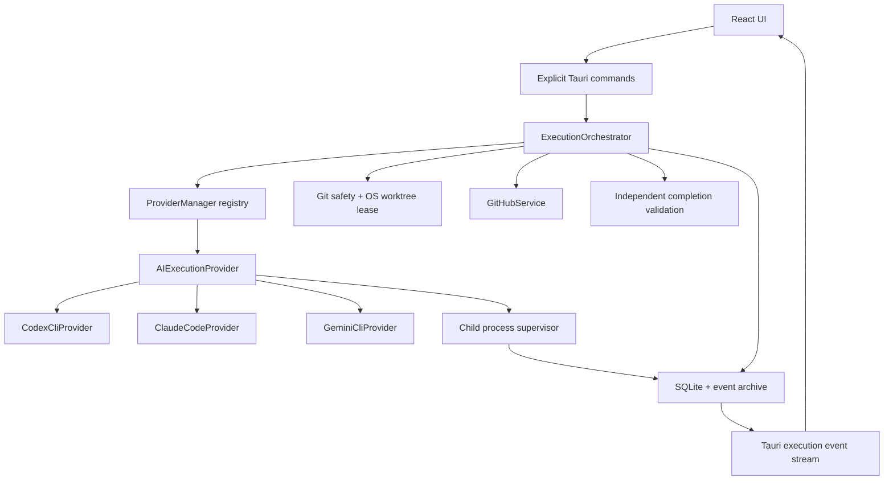

# Architecture

`src/core` owns frontend types, event replay and UI state. `src/components` contains console virtualization and reusable controls. `src/design-system` centralizes branding, theme, material and motion tokens. `src-tauri/src/execution` owns state transitions, prompt generation, queue scheduling, process streaming and validation. `providers` is the only provider-specific layer. `github`, `git`, `persistence`, `security` and `system` own their respective infrastructure concerns.

The backend is the source of truth. UI refreshes retrieve durable snapshots; stdout/stderr travel through an incremental event channel, batched only for rendering. Sequence numbers are assigned under the database mutex and survive restart. Replay merges by sequence, retaining live events that overlap a persisted page.

SQLite migrations are versioned, run before scheduler startup and use WAL plus FULL synchronous writes. Execution and queue-item updates are transactional. Each process attempt is recorded independently. GitHub issue refresh only updates remote metadata, preserving operational state and history.

Queue scheduling is sequential per project and protected by a canonical worktree lease. Separate projects may execute concurrently only when their worktree OS leases differ. Queue operations cannot change a worktree or provider while a project has an active scheduler step.

The instance lock prevents two AiFlow processes from sharing the same local state. Startup pauses queues and moves interrupted active attempts to HUMAN_REVIEW; quota deadlines remain intact. Worktree file locks are released by the OS when the owning process dies. Persistent lock records are diagnostic, never the sole proof of ownership.
